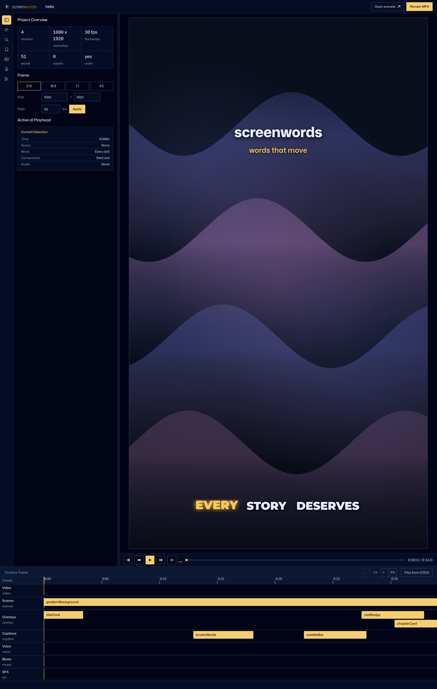
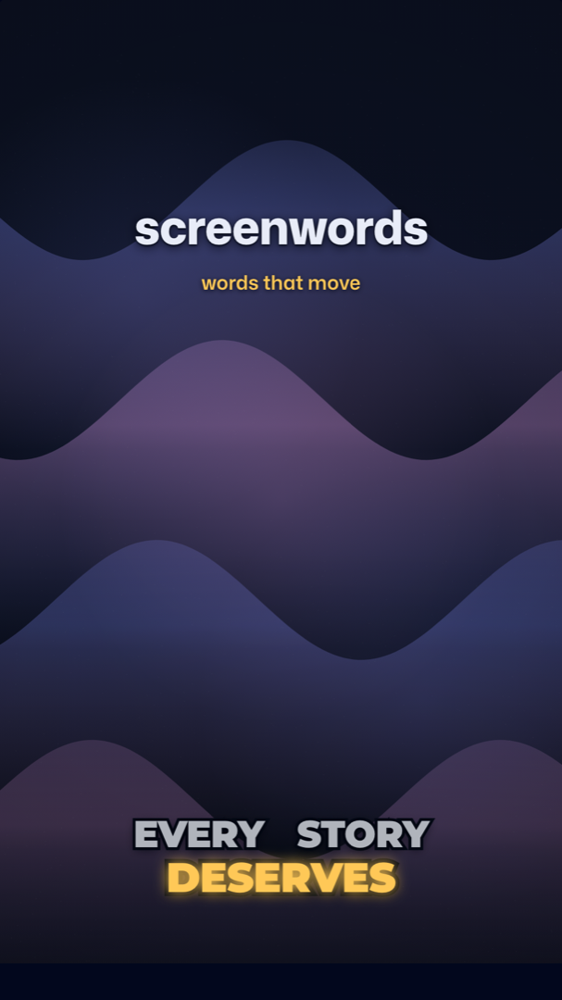
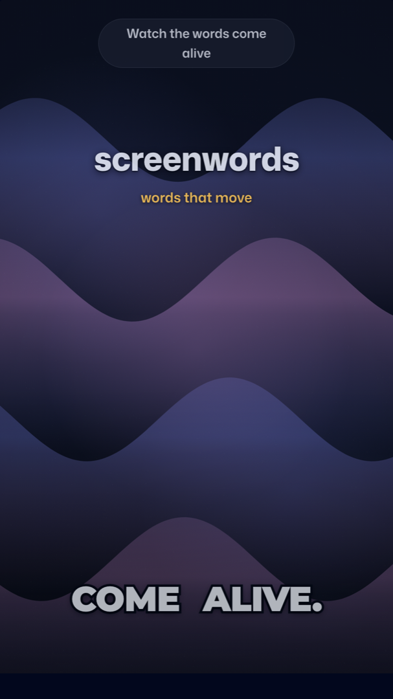
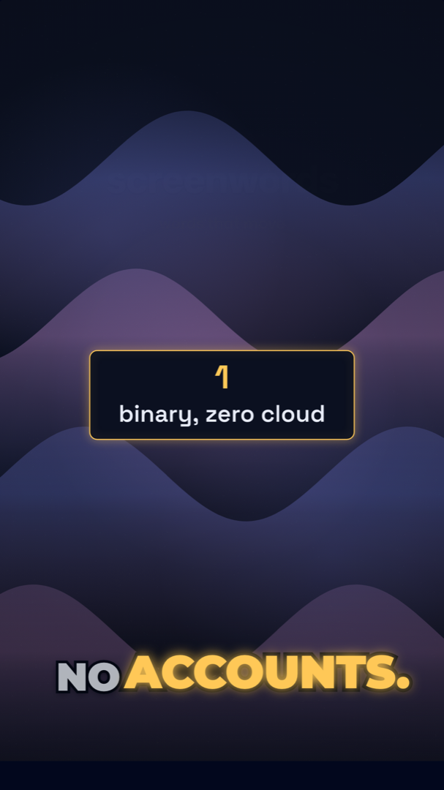
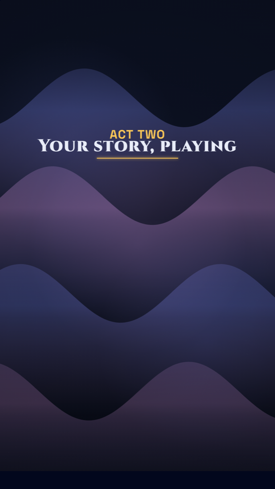

<h1 align="center"></h1>

<p align="center"><strong>Words, on screen, in motion.</strong></p>

<p align="center">
A from-zero video-story engine in pure Rust: a lossless document model, an atomic
edit engine, an MCP-native tool surface, a web editor, an animated HTML renderer
and a deterministic MP4 pipeline — in <strong>one binary</strong>.
</p>

<p align="center">
<a href="https://www.rust-lang.org/">Rust</a> · v1.0.0 · MIT License
</p>

---

**screenwords** turns a written story into an animated video. You author a
transcript; every word carries a rational-precision time anchor. Titles,
captions, kinetic words, charts and backgrounds ride the timeline *on those word
anchors*, so an edit to the script re-flows the film. The same component library
draws the editor stage, the exported player and every MP4 frame — there is one
renderer, not three.


*The web editor: project overview, live 9:16 stage, and the word-anchored multi-track timeline.*

<p align="center">
  
  
  
  
</p>
<p align="center"><em>Four frames from the exported player — title, kinetic words, subtitle + stat badge, chapter card.</em></p>

## Why this exists

The Screenwords macOS app is a word-anchored video editor. This repository is a
from-scratch Rust re-implementation of its engine contracts — built std-only
wherever possible: JSON, a regex subset, DEFLATE, ZIP and HTTP/1.1 (both ways)
are implemented inside the crate. The only external dependencies are ONNX
Runtime for on-device text-to-speech and rustls for HTTPS photo search.

What you get from one `cargo build`:

- **A document model** — rational time, tracks / clips / components / audio
  events, transcripts with per-word anchors; unknown fields survive load/save
  (lossless round-trips).
- **An edit engine** — atomic batches, `ref` chaining, `ifRevision` conflict
  errors, ripple cuts, transcript correction, undo/redo with labels.
- **601 built-in components** — titles, captions, shapes, charts, backgrounds,
  transitions ([full catalog](COMPONENTS.md)), all drawn by one shared library
  injected into both the editor and the player.
- **A web editor** (`screenwords app`) — overview, timeline, transcript, find,
  chapters, subtitles, dry-run cut, TTS synthesis, HTML export and MP4 render,
  every committed change autosaved into the project bundle.
- **An MCP server + stdio proxy** — point any MCP-speaking agent at your editor
  and let it read the transcript, place components, cut the film.
- **On-device TTS** — English and Turkish voices via ONNX models staged at
  first run; nothing leaves the machine.
- **A deterministic MP4 pipeline** — frames are *drawn* at `t = i / fps` over
  CDP (not captured from playback), then muxed with the narration via ffmpeg.

## Quickstart

```bash
git clone https://github.com/halilugur/screenwords
cd screenwords
cargo build --release

# open the bundled demo story in the editor
./target/release/screenwords app examples/hello
# → UI:  http://127.0.0.1:7846/   (MCP on the same port, token printed)

# or start a brand-new vertical project
./target/release/screenwords app my-story --create
```

Type your narration into the Voice panel and press **Generate** — the
transcript is authored and spoken on-device in one step. Add components from
the catalog, then **Create video** for a self-contained animated HTML file or
**Render MP4** for the final cut.

### The 60-second CLI tour

```bash
sw=./target/release/screenwords

sw app examples/hello                  # editor + MCP server, one document
sw render examples/hello --out hi.html # self-contained animated player
sw srt examples/hello --format vtt     # subtitles from the edited transcript
sw chapters examples/hello             # chapters + YouTube description
sw validate some-package.swanim.zip    # lint a .swanim animation package
sw tts "Merhaba dünya" --lang tr --out merhaba.wav
```

MP4 export drives headless Chrome the same way the editor does:

```bash
node tools/render-mp4.mjs --html hi.html --out hi.mp4
```

## The document and its tools

A project is a folder with a `project.json` (the film) and a `revision.json`
(the edit history head). Everything — UI, CLI, MCP tools, renderer — reads and
writes that one document through the edit engine:

```
            ┌────────────┐   MCP (Streamable-HTTP)
   agent ───┤ stdio proxy ├──────────┐
            └────────────┘           ▼
   browser ─────────────────► screenwords app
                                   │  atomic edits, undo, autosave
                                   ▼
                            project.json ◄── screenwords CLI (validate, cut,
                                   │          anchor, srt, chapters, render)
                                   ▼
                     player.html ──► render-mp4.mjs ──► film.mp4
```

### MCP surface

`screenwords mcp` is a drop-in stdio proxy for any MCP client:

```json
{ "mcpServers": { "screenwords": {
    "command": "/path/to/screenwords",
    "args": ["mcp"],
    "env": { "SCREENWORDS_MCP_TOKEN": "<token from the ready line>",
             "SCREENWORDS_MCP_PORT": "7846" } } } }
```

Tools: `get_project`, `get_transcript`, `find_in_transcript`, `list_chapters`,
`list_notes`, `export_subtitles`, `get_history`, `list_components`,
`apply_edits`, `author_transcript`, `set_theme`, `synthesize_speech`,
`find_background`, `undo`, `redo`. One-shot calls work without a client:
`sw call list_components '{}'`.

A story built end-to-end through MCP looks like
[`examples/hello`](examples/hello) — one `author_transcript` call plus one
atomic `apply_edits` batch placed every component and chapter you see in the
screenshots above.

## Architecture

| Module | Role |
| --- | --- |
| `project` | Document model: rational time, tracks/clips/components, word anchors |
| `edits` | The edit engine: atomic batches, conflicts, ripple cuts, undo/redo |
| `swanim` | `.swanim` package validator: manifest rules, limits, blocked-API scan |
| `reads` | Transcript views & search, chapters, notes, SRT/WebVTT export |
| `mcp` / `mcp_proxy` | Streamable-HTTP MCP client and the stdio bridge |
| `server` / `ui` / `render` | MCP server, web editor, shared animated renderer |
| `tts` | On-device ONNX voices (English Phonon, Turkish EMA) + alignment |
| `json`, `regex`, `http(d)`, `inflate`, `zip` | The std-only foundations |

Component renderers live in [`src/assets/components/`](src/assets/components) —
one ordered library injected into both pages at serving time; `cargo test`
fails if the editor and player ever drift apart.

## Requirements

- Rust (stable), any desktop OS Chrome runs on
- [Chrome](https://www.google.com/chrome/) and [ffmpeg](https://ffmpeg.org/) on
  `PATH` for MP4 export (`CHROME_PATH` to override)
- TTS models (~1 GB English/Turkish) are staged into `tts-models/` on first
  synthesis — nothing is committed

## Testing

```bash
cargo test    # 110 tests: engine contracts, renderer data, UI routes, pages
```

## License

[MIT](LICENSE) © Halil UGUR
